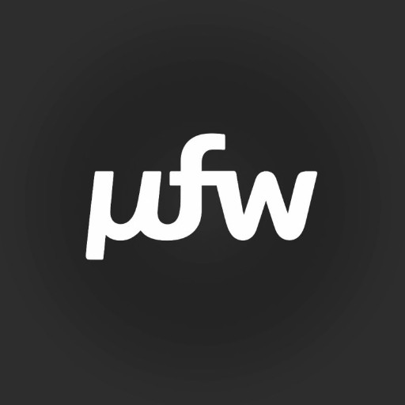

# UFW

**μfw** is short for micro framework - that is the real name; UFW is the ASCII spelling so nobody has to chase `μ` on the keyboard. A compact PHP stack for people who still like PHP, and for people who must use it even if they do not love it.

---

**Probably not for you if:**

- You have decided PHP is a dead language and nothing written in it should ever run in production.
- You want Express-style routing (`app->get('/foo', …)` chains in code). UFW defaults to routes in config and dispatch conventions - patterns can be literal or regex; there is no `app->get` façade out of the box.
- You expect batteries-included auth, ORM, and GraphQL. UFW gives you HTTP plumbing, forms, a MySQL helper, and opinions - you bring the domain.
- You need the framework to natively cover React Server Components, Next.js-shaped routing, tRPC, Bun/Deno, edge/serverless-first deploys, Vite-centric SPAs, or full-stack TypeScript. HTTP here is PHP (Laminas, middleware, server-rendered HTML or JSON); bring a Node BFF if your bingo card requires the rest.
- Your motto is "DI or die": constructor injection everywhere, PSR-11 purity, no singletons, no service locator. UFW is fine with `Registry`, `Db::instance()`, and helpers via `__call`.

**Might be for you if:**

- You care that the stack has years behind it: UFW has been running production code for 8+ years, not a throwaway prototype.
- You want to ship - a page, a form, an endpoint - without the framework eating the time you meant to spend on the product.
- You want PSR-7-ish requests/responses, Laminas middleware, and controllers without importing half of Packagist.
- You are fine with convention over endless configuration files, but still want modules, route types, and per-controller middleware.
- You want Zend-style forms and server-side validators so a malicious client cannot bypass checks - UI/UX convenience on the client can still sit on top.
- You like batteries-included defaults but refuse to be locked in: if stock `Record\Base` or `Controller\Base` is wrong for a corner of the app, you replace them in your namespace and move on.
- Your template engine (Twig, Blade, whatever) and architecture (MVC, CQRS, DDD, hexagonal, …) are non-negotiable. Swap, extend, or replace views, records, models, and helpers as needed.

---

## Documentation

**[→ Documentation index](docs/README.md)** - [quick taste](docs/README.md#quick-taste-15-min) (~15 min) · [full guides](docs/README.md#full-detail-all-guides) (Parts A–D + `Next` links). The guides stress intent and tradeoffs so you can choose deliberately.

| Guide | What you get |
|-------|--------------|
| [Getting started](docs/getting-started.md) | "Hello world" in about 15 minutes - composer, front controller, one route. |
| [Workable demos · ufw-extras](https://github.com/ctebah/ufw-extras) | Companion repo: minimal / skeleton / API / i18n / full-CRUD demo apps, plus recipes (assets build, cron, i18n, autoload) and middleware snippets. The fastest way to see UFW in real shape. |
| [Evaluation FAQ](docs/evaluation-faq.md) | Should we use UFW? TL;DR, poor/strong fit, license, hosting. |
| [Framework analysis](docs/framework-analysis.md) | Honest review: strengths, gaps, recommendations. |
| [Bootstrap & registry](docs/bootstrap-and-registry.md) | Front controller, `Application`, `Registry`. |
| [Middleware](docs/middleware.md) | Pipe, JSON, layout, auth. |
| [Responses: multiformat](docs/responses-multiformat.md) | One action → HTML, JSON, or XHR fragment; `Response::registerFormat()`. |
| [Flavors / multi-app](docs/flavors-multi-app.md) | Env + flavor - app pattern, not core UFW. |
| [Security](docs/security.md) · [SECURITY.md](SECURITY.md) | Deployment checklist and vulnerability reporting. |
| [Contributing](CONTRIBUTING.md) | PR style, scope rules, local checks. |
| [Changelog](CHANGELOG.md) | Full history of releases and changes. |
| [License](LICENSE) | 0BSD |

## Install

```bash
composer require ctebah/ufw
```

Your application still defines `APPLICATION_PATH`, boots `Application`, and loads `config/app.php` - this package is the library, not a turnkey installer. See [Getting started](docs/getting-started.md) for the smallest end-to-end example.

## Author

Original author: [ctebah](https://github.com/ctebah) · Repository: [github.com/ctebah/ufw](https://github.com/ctebah/ufw). If you fork UFW, ship it in a product, or write about it, a mention of the project (and optionally the name above) is appreciated - not required by the license, but it keeps the universe slightly more polite.

## License

[Zero-Clause BSD (0BSD)](LICENSE) - use, change, and redistribute freely for any purpose. The software is provided as-is; the author is not liable for damages arising from its use (standard open-source liability limitation, not a joke license).

SPDX: `0BSD`

---

<p align="center">
  <br />
  <sub><strong>μfw</strong> · micro framework</sub>
</p>
